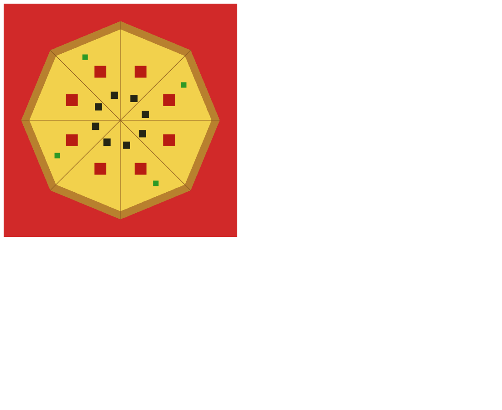

# Pizza Pie (HW 1)

A 2D pizza drawn with WebGL 2.0 in a single HTML file. The crust, slice lines, and toppings are all placed with polar coordinates.

## Overview

The program draws an 8 slice pizza with three kinds of toppings on a red tablecloth background. It was a homework for my graphics class and meets these requirements:

- Vertices along the crust are placed with polar coordinates on a circle centered at (0,0)
- At least 3 calls to `gl.drawArrays` (the program makes 6)
- `gl.POINTS` plus two other primitive types (it uses `TRIANGLE_FAN`, `TRIANGLE_STRIP`, and `LINES`)
- At least three colors
- One self-contained HTML file

## Features

- Yellow cheese base and a golden brown crust ring
- Eight dark brown cut lines running from the center out to the crust
- Pepperoni (8, point size 26), olives (8, point size 16), and green peppers (4, point size 12, on every other slice)
- Red tablecloth background from `gl.clearColor(0.82, 0.16, 0.16, 1.0)`
- A static image: everything is drawn once inside `init()`, so there is no render loop

## How It Works

### Shaders

The vertex shader passes the position straight through and reads the point size from a uniform. The fragment shader paints every fragment with a single uniform color, so one shader pair handles every shape.

```glsl
in vec4 aPosition;
uniform float uPntSize;

void main()
{
  gl_Position = aPosition;
  gl_PointSize = uPntSize;
}
```

Only x and y are sent from JavaScript. The missing z and w components default to 0 and 1.

### Geometry from polar coordinates

All shapes come from three parameters: `NUM_SLICES = 8`, `R_CHEESE = 0.78`, and `R_CRUST = 0.85`. Each point is converted with `x = R * cos(angle)` and `y = R * sin(angle)`.

```js
cheeseVerts.push( 0.0, 0.0 );   // center of the pizza
for (var i = 0; i <= NUM_SLICES; i++)
{
    var angle = (2.0 * Math.PI * i) / NUM_SLICES;
    cheeseVerts.push( R_CHEESE * Math.cos(angle), R_CHEESE * Math.sin(angle) );
}
```

- **Cheese base** (`TRIANGLE_FAN`): the center point plus 9 rim points. The loop runs to `i <= NUM_SLICES`, so the last point repeats the first and the fan closes.
- **Crust** (`TRIANGLE_STRIP`): 18 vertices that alternate between the inner radius (0.78) and the outer radius (0.85), forming a ring.
- **Cut lines** (`LINES`): 8 pairs of vertices, each going from (0,0) to the crust edge at a slice boundary.
- **Toppings** (`POINTS`): offsetting the slice index moves a topping off the cut line. Pepperoni uses `i + 0.5` at radius 0.45 to land in the middle of each slice, olives use `i + 0.3` at radius 0.22, and green peppers step by 2 with `i + 0.65` at radius 0.62.

### Draw calls

Every shape follows the same steps: create a buffer, bind it, upload the `Float32Array` with `gl.STATIC_DRAW`, point `aPosition` at it with 2 components, set `uColor` (and `uPntSize` for points), then call `gl.drawArrays`. The uniform locations `uColor_location` and `uPntSize_Loc` are looked up once before drawing.

Depth testing is not enabled, so draw order decides what ends up on top. The cheese and crust are drawn first and the toppings last.

## Files

- `CG_HW1_PizzaPie_DanielOni.html`: the program, with both shaders and `initShaders` embedded
- `CG_HW1_PizzaPie_DanielOni_Preview.png`: preview capture of the running program
- `PizzaPie_Complete_Beginners_Guide.md`: line by line walkthrough of the code, covering the shaders, polar coordinates, each primitive type, and the buffer and draw pattern

## How to Run It

Open `CG_HW1_PizzaPie_DanielOni.html` in any browser that supports WebGL 2.0. Everything is inside the one file, including `initShaders`, so there is nothing else to copy in.

## Screenshots

These are preview captures of the program running in a browser.


