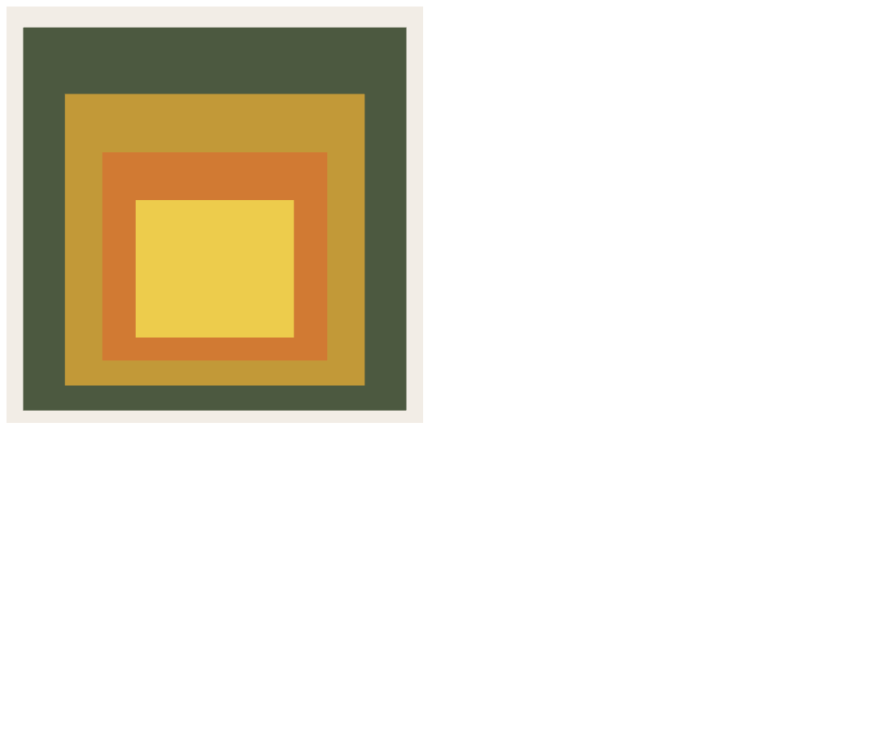

# Homage to the Square (HW 1)

A WebGL 2.0 take on Josef Albers' "Homage to the Square" paintings, where four nested squares are drawn from one shared unit square using uniforms.

## Overview

Albers painted a long series of nested, solid colored squares that sit low on the canvas with uneven borders. This program recreates that layout in 2D. It was a homework for my graphics class and meets these requirements:

- 3 to 4 nested squares, each a solid color
- All four edges of every square visible, with unequal spacing between them
- Every square centered horizontally
- The squares sitting low, toward the bottom of the canvas
- Uniform variables drive the drawing
- Only one vertex shader and fragment shader pair
- One `drawArrays` call per square

## Features

- Four nested squares in a warm earth tone palette: olive green, golden ochre, burnt orange, and a warm yellow in the center
- Off-white background, like an old canvas (`gl.clearColor(0.95, 0.93, 0.90, 1.0)`)
- Borders are narrow at the bottom, a little wider at the sides, and widest at the top, following the Albers proportions
- A static image drawn once inside `init()`

## How It Works

### One square, four draws

Only one shape is ever uploaded to the GPU: a unit square from (-1,-1) to (1,1), stored as 4 vertices and drawn as a `TRIANGLE_FAN`. The vertex shader scales and moves it using two `vec2` uniforms:

```glsl
in vec4 aPosition;
uniform vec2 uOffset;
uniform vec2 uScale;

void main()
{
    gl_Position = vec4(aPosition.x * uScale.x + uOffset.x,
                       aPosition.y * uScale.y + uOffset.y,
                       0.0, 1.0);
}
```

Because the base square spans -1 to 1, `uScale` is the half width and half height of the square on screen, and `uOffset` is its center. The fragment shader outputs a `uColor` uniform as the solid fill.

### Square table

The JavaScript keeps an array of four objects, each with a color, `scaleX`, `scaleY`, `offsetX`, and `offsetY`:

| Square | Color | scaleX | scaleY | offsetY |
|---|---|---|---|---|
| 0 (outer) | olive green | 0.92 | 0.92 | -0.02 |
| 1 | golden ochre | 0.72 | 0.70 | -0.12 |
| 2 | burnt orange | 0.54 | 0.50 | -0.20 |
| 3 (inner) | warm yellow | 0.38 | 0.33 | -0.26 |

Every `offsetX` is 0, which keeps the squares centered horizontally. Each inner square is a little shorter than it is wide and shifted further down, so its bottom edge stays close to the next square's bottom edge while the gap above it grows. For example, square 1 sits 0.12 above the bottom of square 0 but 0.32 below its top.

### Draw loop

Uniform locations are looked up once. A loop then walks the array from largest to smallest, sets the three uniforms, and draws:

```js
gl.uniform4fv( uColor_loc, sq.color );
gl.uniform2f( uOffset_loc, sq.offsetX, sq.offsetY );
gl.uniform2f( uScale_loc, sq.scaleX, sq.scaleY );
gl.drawArrays( gl.TRIANGLE_FAN, 0, 4 );
```

Depth testing is off, so drawing back to front puts each smaller square on top of the one before it.

## Files

- `CG_HW1_HomageToTheSquare_DanielOni.html`: the program, with both shaders and `initShaders` embedded
- `CG_HW1_HomageToTheSquare_DanielOni_Preview.png`: preview capture of the running program

## How to Run It

Open the HTML file in a browser with WebGL 2.0. It is self-contained, with `initShaders` written inside the file, so no other files are needed.

## Screenshots

These are preview captures of the program running in a browser.


