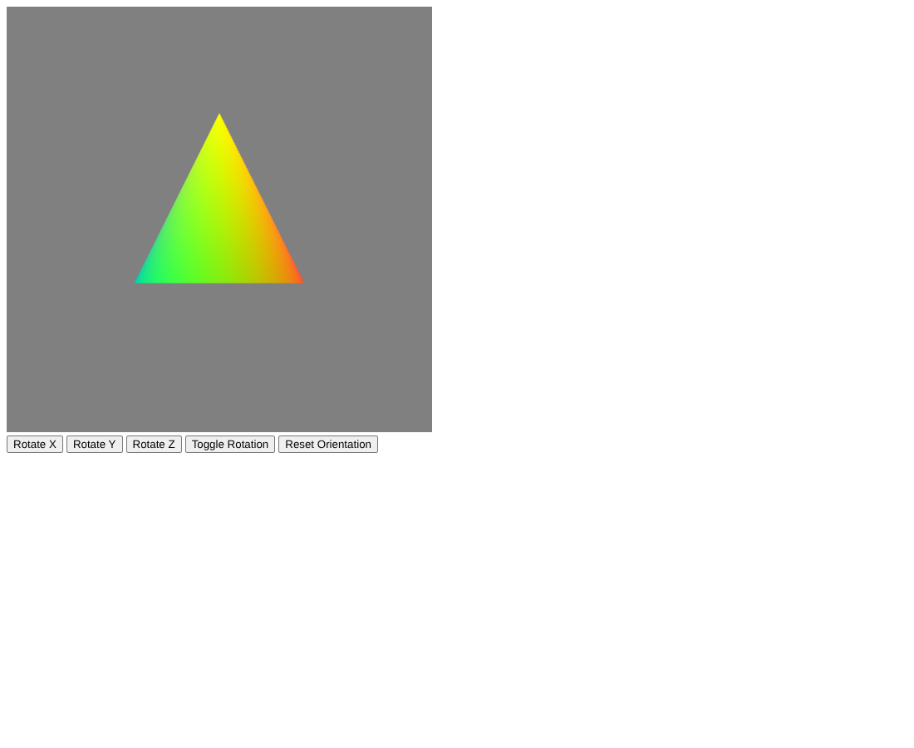

# Cone Extension

A rotating 3D cone in WebGL 2.0, built from two triangle fans whose base circle is generated with polar coordinates.

## Overview

This project extends a class starter that drew a single triangle in 3D with buttons to rotate it around the X, Y, or Z axis. `Cone.js` replaces that triangle with a closed cone. The goals were:

- Draw a cone using `TRIANGLE_FAN`
- Generate the circle at the base with polar coordinates
- Keep the changes inside the vertex and color setup and the draw calls in the render loop
- Choose colors and the number of vertices around the circle

## Features

- Cone with a yellow tip and sides that fade through a full rainbow around the base
- Closed bottom cap with a darker rainbow rim and a dark gray center
- 36 segments around the circle for a smooth edge
- Buttons to choose the rotation axis (Rotate X, Rotate Y, Rotate Z), start and stop the spin (Toggle Rotation), and zero all angles (Reset Orientation)
- Depth testing so the near side of the cone hides the far side

## How It Works

### Geometry

The vertex and color arrays are built when the script loads, using `numSegments = 36`, `apexY = 0.5`, `baseY = -0.3`, and `baseRadius = 0.4`. The circle lies in the XZ plane, so Y points up:

```js
for (var i = 0; i <= numSegments; i++) {
    var angle = (2.0 * Math.PI * i) / numSegments;
    pointsArr.push(baseRadius * Math.cos(angle), baseY, baseRadius * Math.sin(angle));
    ...
}
```

Both fans live in one array:

1. **Side**: the apex at (0, 0.5, 0) followed by 37 circle points. The extra point repeats the first one so the fan closes all the way around (38 vertices).
2. **Base**: the center (0, -0.3, 0) followed by the same 37 circle points in reverse order, so the cap winds the opposite way from the side and faces down (38 vertices).

### Colors

Each rim vertex gets a color from three cosine waves offset by about a third of a turn (2.094 and 4.189 radians), which produces a smooth rainbow:

```js
0.5 + 0.5 * Math.cos(2.0 * Math.PI * t),
0.5 + 0.5 * Math.cos(2.0 * Math.PI * t + 2.094),
0.5 + 0.5 * Math.cos(2.0 * Math.PI * t + 4.189),
```

The base uses `0.3 + 0.3 * cos(...)` for a darker version of the same pattern.

### Buffers and shaders

Positions (3 floats per vertex) and colors (4 floats per vertex) go into two separate buffers, `vBuffer` and `cBuffer`, bound to `aPosition` and `aColor`. The vertex shader builds rotation matrices `rx`, `ry`, and `rz` from the `uTheta` vec3 uniform and computes `gl_Position = rz * ry * rx * aPosition`. The fragment shader outputs the interpolated `vColor`.

### Render loop

`render()` clears to gray, advances `theta[axis]` by `rotSpeed = 0.008` radians when rotation is on, uploads `uTheta`, and draws the two fans:

```js
gl.drawArrays(gl.TRIANGLE_FAN, 0, numSideVerts);              // cone sides
gl.drawArrays(gl.TRIANGLE_FAN, numSideVerts, numBaseVerts);    // base cap
```

The axis buttons only change which entry of `theta` is active. The render loop uploads `uTheta` every frame, so Reset Orientation takes effect right away even while the spin is paused.

## Files

- `Cone.js`: cone geometry, colors, buffer setup, button handlers, and the render loop
- `Cone.html`: canvas, buttons, and the inline shaders; it follows the class 3DViewer example (same shaders, `uTheta` uniform, and button ids), loads `Cone.js`, and adds the Reset Orientation button
- `initShaders.js`: the class shader loader
- `Cone_Preview.png`: preview capture of the running program

## How to Run It

Everything is already in this folder. Open `Cone.html` in a browser with WebGL 2.0. Click a Rotate button to pick an axis and then Toggle Rotation to start it spinning.

## Screenshots

These are preview captures of the program running in a browser.


