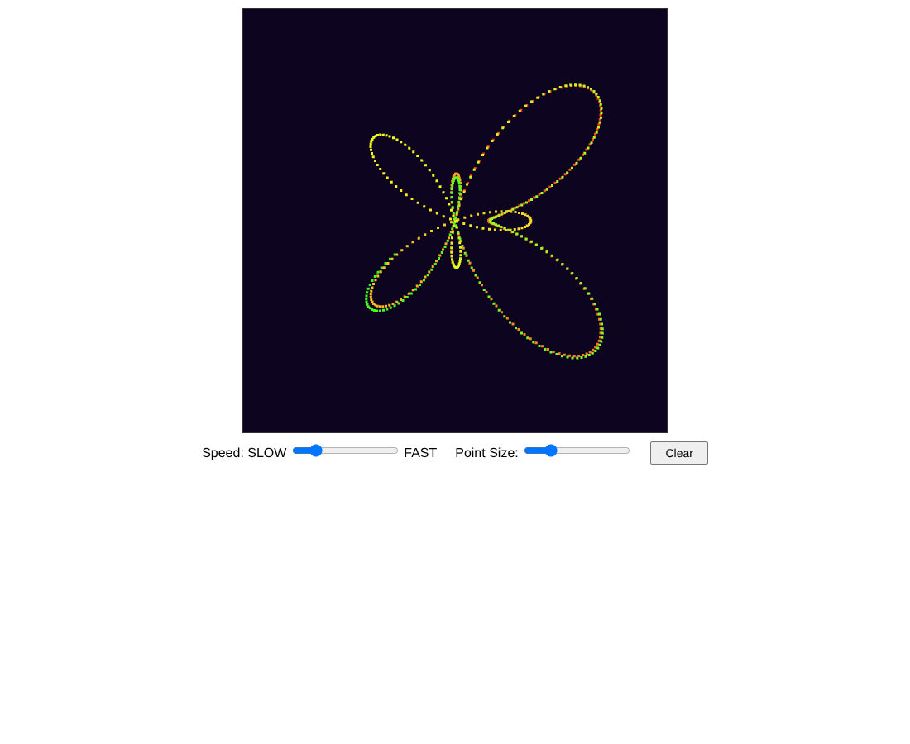

# Move That Point: Butterfly Curve (HW 2.1)

A WebGL 2.0 animation where a single point traces the butterfly curve and leaves a color cycling trail behind it.

## Overview

The program moves one point along a parametric curve, frame by frame, and keeps every past position on screen so the full shape builds up over time. It was a homework for my graphics class and meets these requirements:

- The curve is not a circle and crosses itself
- A slider controls the speed
- A button clears the canvas once and drawing continues
- A uniform in the vertex shader sets the x and y offset of the point (z stays 0)
- The parametric equation is computed inside the render loop
- The trail stays visible by creating the WebGL 2.0 context with `preserveDrawingBuffer: true`
- The whole path stays inside the default -1 to 1 clip space

## Features

- Butterfly curve traced by a single moving point
- Rainbow trail on a dark navy background
- Speed slider labeled SLOW to FAST (0.0001 to 0.006, default 0.0012)
- Point Size slider (1 to 10, default 3)
- Clear button that wipes the trail while the animation keeps running

## How It Works

### The curve

The butterfly curve is a polar equation:

```
r = e^sin(theta) - 2cos(4theta) + sin^5((2theta - pi) / 24)
```

Each frame converts it to x and y with `x = r * sin(theta)` and `y = r * cos(theta)`, scaled by 0.22 so the shape fits the canvas. A clamp to [-1, 1] acts as a final safety check.

```js
theta += speed * 16.0;
var r = Math.exp(Math.sin(theta))
      - 2.0 * Math.cos(4.0 * theta)
      + Math.pow( Math.sin((2.0 * theta - Math.PI) / 24.0), 5.0 );
var scale = 0.22;
var x = scale * r * Math.sin(theta);
var y = scale * r * Math.cos(theta);
```

### Shaders without a vertex buffer

The vertex shader has no attributes. The point's position comes entirely from uniforms:

```glsl
uniform float uOffsetX;
uniform float uOffsetY;
uniform float uPointSize;

void main()
{
    gl_Position = vec4(uOffsetX, uOffsetY, 0.0, 1.0);
    gl_PointSize = uPointSize;
}
```

The fragment shader outputs a `uColor` uniform. Each frame draws exactly one point with `gl.drawArrays(gl.POINTS, 0, 1)`.

### Keeping the trail

The context is created with `canvas.getContext('webgl2', { preserveDrawingBuffer: true })`, and `render()` never calls `gl.clear()`. The browser keeps the previous frame's pixels, so every point drawn stays on screen. The Clear button runs `gl.clear(gl.COLOR_BUFFER_BIT)` once and the loop carries on drawing.

### Color cycling

A small `hslToRgb(h, s, l)` helper converts a hue to RGB. The hue is `(theta * 0.03) % 1.0` with saturation 0.95 and lightness 0.55, so the color drifts slowly through the spectrum as the point moves.

### Setup

All four uniform locations (`uOffsetX_Loc`, `uOffsetY_Loc`, `uPointSize_Loc`, `uColor_Loc`) are looked up once in `init()`, and the slider and button handlers are attached there as well. The render loop only computes the curve, sets uniforms, draws, and calls `requestAnimationFrame`.

## Files

- `CG_HW2_MoveThatPoint_DanielOni.html`: the program, with both shaders, `initShaders`, and the HSL helper embedded
- `CG_HW2_MoveThatPoint_DanielOni_Preview.png`: preview capture of the running program

## How to Run It

Open the HTML file in a browser that supports WebGL 2.0. It is self-contained, with `initShaders` inside the file. Move the Speed slider to change how fast the point travels, and press Clear to wipe the trail.

## Screenshots

These are preview captures of the program running in a browser.


