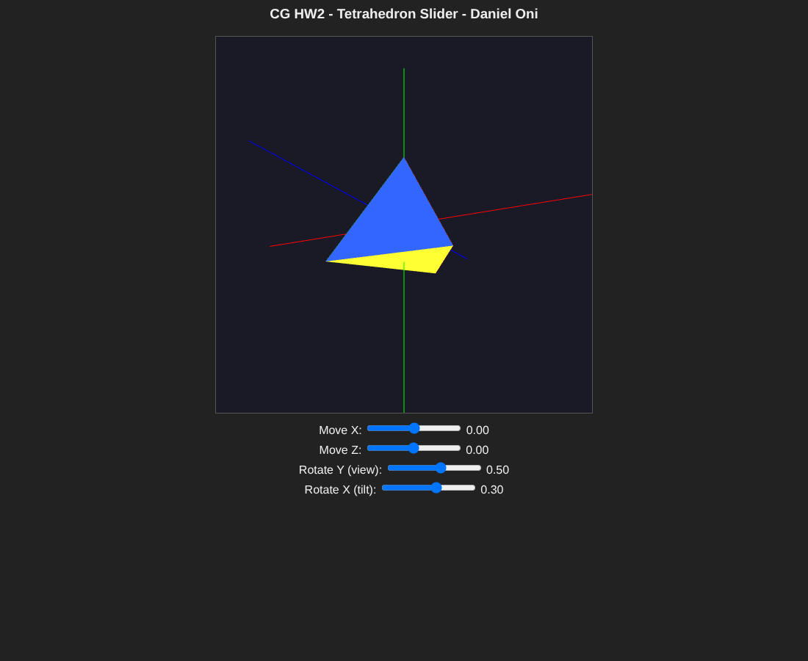

# Tetrahedron Slider (HW 2.2)

A WebGL 2.0 scene with a four colored tetrahedron that slides across the XZ plane while the world axes stay fixed, with sliders to rotate the view.

## Overview

The program draws a tetrahedron and the three world coordinate axes, then lets the user move the tetrahedron and look at the scene from different angles. It was a homework for my graphics class and meets these requirements:

- Draw a tetrahedron
- Draw lines for the X, Y, and Z axes in world coordinates
- Move the tetrahedron in the XZ plane with sliders, using uniform variables
- Keep the axes fixed while the tetrahedron moves
- Provide a way to view the scene from different angles
- One self-contained HTML file

## Features

- Tetrahedron with one solid color per face: red front, green left, blue right, yellow bottom
- Axis lines from -1 to 1: X in red, Y in green, Z in blue
- Four sliders, each with a live value readout:
  - Move X and Move Z (-0.8 to 0.8)
  - Rotate Y (view), -3.14 to 3.14, starting at 0.5
  - Rotate X (tilt), -1.57 to 1.57, starting at 0.3
- Simple perspective so the shape reads as 3D
- Depth testing so faces sort correctly

## How It Works

### Geometry and interleaved buffers

The tetrahedron has four corners: a top vertex at (0, 0.4, 0) and three base vertices at y = -0.2. Each face is its own triangle, so there are 12 vertices drawn with `gl.TRIANGLES`. The axes are 6 vertices drawn with `gl.LINES`.

Both buffers store interleaved data as X, Y, Z, R, G, B. A helper binds a buffer and sets both attributes using a 24 byte stride (6 floats times 4 bytes) and a 12 byte color offset:

```js
gl.vertexAttribPointer( aPosition, 3, gl.FLOAT, false, 24, 0 );
gl.vertexAttribPointer( aColor, 3, gl.FLOAT, false, 24, 12 );
```

This function, `bindBufferAndSetAttributes`, is called before each draw so the same attributes can read from either buffer.

### Vertex shader

All transforms happen in the vertex shader using five float uniforms:

- `uTranslateX` and `uTranslateZ` move the tetrahedron in the XZ plane
- `uIsAxis` acts as a flag; when it is 1.0 the translation is skipped
- `uRotateY` and `uRotateX` rotate the whole scene for the view

```glsl
if (uIsAxis < 0.5) {
    pos.x += uTranslateX;
    pos.z += uTranslateZ;
}
```

After translation, the shader rotates around Y and then X with explicit sine and cosine terms, then applies a simple perspective divide:

```glsl
float d = 2.0;
float scale = d / (d + pos.z);
pos.x = pos.x * scale;
pos.y = pos.y * scale;
pos.z = pos.z * 0.5;
```

### Render loop

Each frame clears the color and depth buffers and sets the two rotation uniforms, which apply to everything. The axes are drawn first with `uIsAxis` set to 1.0 and zero translation. The tetrahedron is drawn second with `uIsAxis` set to 0.0 and the current slider values. One shader handles both objects, and the flag is what keeps the axes in place.

Uniform locations are looked up once in `init()`.

## Files

- `CG_HW2_Tetrahedron_DanielOni.html`: the program, with both shaders, `initShaders`, and the slider controls embedded
- `CG_HW2_Tetrahedron_DanielOni_Preview.png`: preview capture of the running program

## How to Run It

Open the HTML file in a browser with WebGL 2.0. It is self-contained, so nothing else needs to be in the folder. It starts at a slight angle (Y at 0.5 and X at 0.3) so you can see it is 3D right away. Move the X and Z sliders and you can see the tetrahedron slide around while the axes stay in place.

## Screenshots

These are preview captures of the program running in a browser.


