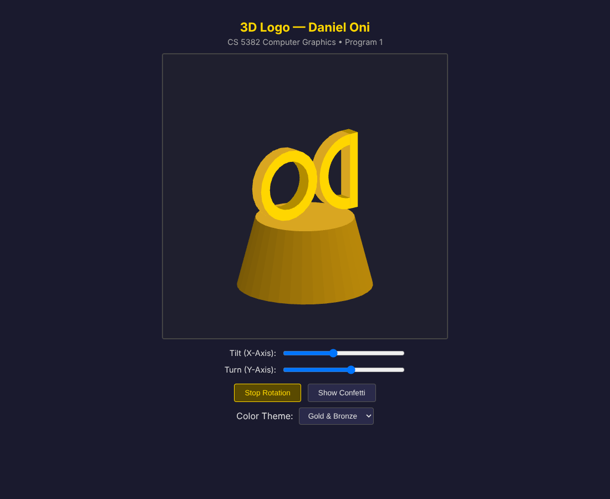

# Program 1: 3D "DO" Logo on a Pedestal

A WebGL 2.0 scene of the initials "DO" spinning on top of a tapered pedestal, with view sliders, color themes, and falling confetti animated in the vertex shader.

## Overview

The program builds a solid 3D logo of my initials on a cylinder pedestal for my graphics class. The pedestal needed different top and bottom radii, a base parallel to the XZ plane, and polar coordinate vertices. Every object had to be a closed triangle mesh inside the default clipping cube, with no vertex uploads in the render loop, three kinds of interaction, two view rotations, and animation.

## Features

- Tapered pedestal with closed caps, plus an extruded "D" and "O" that spin on top while the pedestal stays still
- **Sliders**: Tilt (X-Axis) from -90 to 90 degrees and Turn (Y-Axis) from -180 to 180 degrees
- **Buttons**: Stop Rotation / Auto-Rotate Letters, and Show Confetti / Hide Confetti
- **Dropdown**: four color themes (Gold & Bronze, Ocean Blue, Forest Green, Neon Glow), each with its own background
- 40 confetti triangles that fall and drift through the scene

## How It Works

### Geometry

Shapes are built with `addTriangle` and `addQuad`, at 7 floats per vertex (x, y, z, w, r, g, b).

- **`generatePedestal`** walks two circles (radius 0.48 at the bottom, 0.35 at the top) with `x = r * cos(theta)` and `z = r * sin(theta)`. Each of the 36 segments adds two side triangles and one triangle for each cap.
- **`generateBox`** builds the vertical bar of the D from two opposite corners.
- **`generateRing`** extrudes a ring 0.10 deep along Z with front, back, outer, and inner faces, and caps the open ends of a partial ring. The D uses it from -pi/2 to pi/2 and the O from 0 to 2pi.

The D curve's outer radius equals half the bar height, so it meets the bar flush. The letters span x = -0.4375 to 0.4375. Rotation happens around the origin, so centering the pair at x = 0 makes them spin in place instead of orbiting the pedestal.

### One buffer, separate draw calls

`buildAndUploadVertices()` packs the pedestal, D, O, and confetti into one `Float32Array` (1,752 vertices) and records a start index and count for each. It runs once in `init()` and again only when the theme changes, since colors live in the vertex data.

### Vertex shader

The shader builds four rotation matrices from float uniforms and applies them in this order:

```glsl
gl_Position = rx * ry * rz * ryExtra * pos;
```

`uThetaX` and `uThetaY` come from the sliders in radians, and `uThetaZ` stays 0. `uExtraThetaY` is the letter spin: the render loop sets it to 0 for the pedestal and to the auto rotate angle for the letters, so one shader gives two behaviors.

### Confetti

The confetti positions never change in the buffer. When `uConfettiAnim` is 1.0, the shader moves each vertex using `uTime`, with the vertex's own x and z as a seed:

```glsl
float seed = pos.x * 137.0 + pos.z * 251.0;
float fallSpeed = 0.3 + 0.2 * sin(seed);
float y = pos.y - mod(uTime * fallSpeed, 1.6);
if (y < -0.8) y += 1.6;
```

Small sine and cosine drifts are added to x and z. The render loop resets `uExtraThetaY` to 0 before drawing the confetti so it does not spin with the letters.

## Files

- `CG_Program1_OniDaniel.html`: shaders, controls, and page styling; this is the file to open
- `CG_Program1_OniDaniel.js`: geometry, color themes, `initShaders`, event handlers, and the render loop
- `CG_Program1_OniDaniel_Preview.png`: preview capture of the running program
- `CG_Program1_StudyGuide_OniDaniel.pdf`: presentation study guide
- `CG_Program1_VideoScript_OniDaniel.md`: 2 minute video script (one action line says `uIsConfetti/uConfettiTime`; the uniforms in the code are `uConfettiAnim` and `uTime`)

## How to Run It

Put the HTML and JS files in the same folder and open the HTML file in a browser that supports WebGL 2. It does not need any extra class utility files because `initShaders` is written inside the JS file.

## Screenshots

These are preview captures of the program running in a browser.


