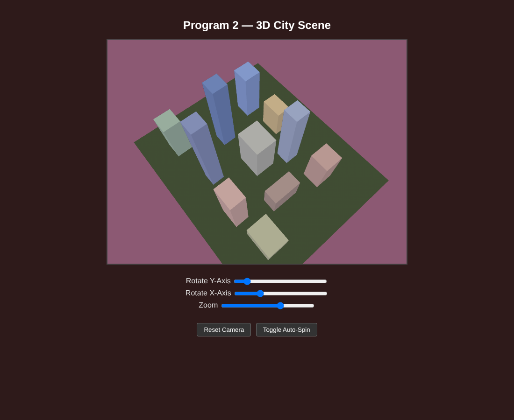

# 3D City Scene with Perspective Projection

A WebGL 2.0 city skyline built from 11 scaled and translated copies of one cube mesh, viewed through a perspective camera that orbits the scene.

## Overview

This project draws a small 3D city for my graphics class. The goals were:

- Build the whole city from 9 to 12 instances of a single cube mesh, each placed with its own scale and translation.
- Render the scene with a perspective projection and a clearly defined viewing volume.
- Let the user move the camera around the city.

## Features

- 11 buildings of different heights and footprints arranged in three staggered rows, each with its own color tint.
- A flattened cube used as a green ground plane under the buildings.
- A warm dusk background color.
- **Rotate Y-Axis** slider (0 to 360 degrees) to orbit around the city.
- **Rotate X-Axis** slider (5 to 85 degrees) to raise or lower the camera.
- **Zoom** slider (5 to 25 units) to change the camera distance.
- **Reset Camera** button that restores the default view and slider positions.
- **Toggle Auto-Spin** button that slowly orbits the camera and keeps the Y slider in sync.

## How It Works

**Geometry.** `buildCube()` expands 8 corner points and a face index table into 36 vertices (12 triangles) for a unit cube centered at the origin. Each face gets a gray base color, so the sides of a building read differently. Positions and colors go into two buffers, read by the `aPosition` and `aColor` attributes.

**Instancing with model matrices.** Each building is an entry in the `buildings` array with a translation, a scale, and an RGB tint. `modelMatrix(tx, ty, tz, sx, sy, sz)` returns a column major scale then translate matrix, and `ty` is set to half the building height so every base sits on y = 0. Before each draw, the base face colors are multiplied by the tint and written to a color buffer. The ground is the same cube scaled to 14 x 0.1 x 12.

**Shaders.** The vertex shader applies the full transform chain, and the fragment shader outputs the interpolated color:

```glsl
gl_Position = uProjectionMatrix * uViewMatrix * uModelMatrix * aPosition;
```

**Projection.** `perspectiveMatrix(fovy, aspect, near, far)` builds the frustum matrix directly in column major order. The scene uses a 45 degree vertical field of view, the canvas aspect ratio (640 / 480), a near plane at 0.1, and a far plane at 100. The -1 in the third column copies -z into w, so the divide by w after the vertex shader makes far buildings smaller.

```js
var f = 1.0 / Math.tan(fovy * Math.PI / 360.0);  // cot(fovy/2)
var rangeInv = 1.0 / (near - far);
return new Float32Array([
    f / aspect, 0,  0,                          0,
    0,          f,  0,                          0,
    0,          0,  (near + far) * rangeInv,   -1,
    0,          0,  near * far * rangeInv * 2,  0
]);
```

The projection matrix is uploaded once at init time since it never changes.

**Camera.** Every frame, the eye position is computed from spherical coordinates around a target at (0, 1.5, 0.5), using `camTheta` for the orbit angle, `camPhi` for elevation, and `camRadius` for distance. `lookAtMatrix(eye, at, up)` builds the view matrix from the cross product basis of the viewing direction and the world up vector. Depth testing is on so nearer buildings hide the ones behind them, and the scene redraws through `requestAnimationFrame`.

## Files

- `Program2_CityScene_DO.html`: the program, with the shaders, controls, and all scene code. This is the file to open.
- `initShaders.js`: the class utility that compiles and links the shader program.
- `Program2_CityScene_DO_Preview.png`: preview capture of the scene running in a browser.

## How to Run It

Keep `initShaders.js` in the same folder as the HTML and open `Program2_CityScene_DO.html` in a browser that supports WebGL 2.0. There is no webcam here, so opening it straight from the file works.

## Screenshots

These are preview captures of the program running in a browser.


