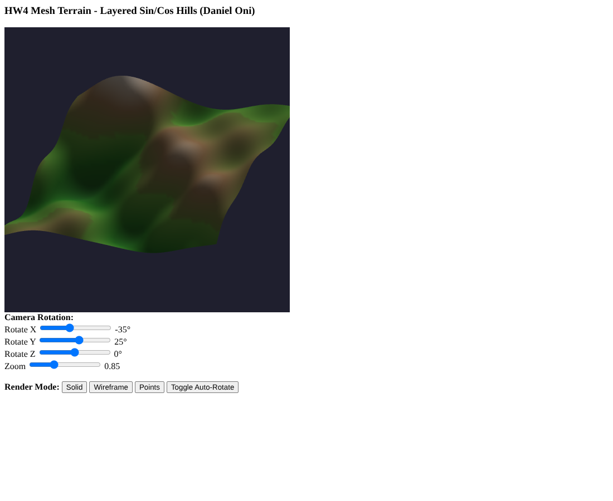
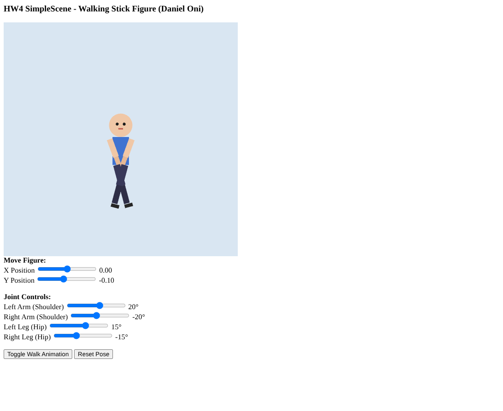

# HW 4: Simple Scene and Mesh Terrain

Two WebGL 2.0 programs: a jointed 2D stick figure built from instanced basic shapes, and a lit 3D terrain mesh generated on the XZ plane.

## Overview

This homework for my graphics class has two parts.

**4.1 SimpleScene:** build a jointed figure in the XY plane using only basic 2D shapes (triangle, rectangle, circle approximation), with every part made by applying an instance transform to a shared shape. The figure needs at least 2 independent joints, it has to move around the scene as a whole, and the user has to control both the joints and the figure's position.

**4.2 MeshTerrain:** generate a finite planar triangle mesh with surface normals, aligned with the XZ plane and centered at the origin. The height has to come from random values or a math function other than the hat function, and the user needs a way to view the mesh from different angles.

Each part is a self contained HTML file with a matching JS file.

## Features

**SimpleScene (stick figure)**

- Torso, head, arms, forearms, thighs, shins, feet, eyes, and mouth, all drawn from one unit rectangle and one circle.
- Four joint sliders (left and right shoulder, left and right hip) plus X Position and Y Position sliders for the whole figure.
- **Toggle Walk Animation** swings the limbs in opposite phase and walks the figure back and forth. **Reset Pose** restores the defaults.

**MeshTerrain**

- A 60 by 60 grid of rolling hills spanning -1 to 1 in X and Z, colored by height from green valleys to light peaks.
- Ambient plus diffuse lighting from a fixed directional light.
- Rotate X, Rotate Y, Rotate Z, and Zoom sliders, **Solid**, **Wireframe**, and **Points** draw modes, and **Toggle Auto-Rotate**.

## How It Works

**Stick figure.** `createRectangleVAO` stores a unit square from (-0.5, -0.5) to (0.5, 0.5), and `createCircleVAO` stores a 36 segment triangle fan of radius 0.5. Both are drawn with `TRIANGLE_FAN`. Each body part is one of these shapes with its own model matrix, built on the CPU with column major helpers (`mat4_translate`, `mat4_rotateZ`, `mat4_scale`, `mat4_multiply`) and chained with `mat4_chain`. The result goes to the vertex shader as `uniform mat4 uModelMatrix`, and the part color goes to the fragment shader as `uniform vec4 uColor`.

The joints are hierarchical. Every part starts from a root translation for the figure position. A limb translates to its pivot, rotates, and that base matrix is then reused by the child segment:

```js
var leftUpperArmBase = mat4_chain(
    rootT,
    mat4_translate(leftShoulderX, leftShoulderY, 0.0),
    mat4_rotateZ(leftArmRad)
);
var leftForearmMatrix = mat4_chain(
    leftUpperArmBase,
    mat4_translate(0.0, -armH, 0.0),        // move to elbow position
    mat4_translate(0.0, -foreH / 2.0, 0.0), // offset forearm center
    mat4_scale(foreW, foreH, 1.0)
);
```

Because the forearm, shin, and foot start from their parent's base matrix, they follow the shoulder or hip rotation automatically.

**Terrain.** The height function adds four sine and cosine layers at different frequencies and phases:

```js
var h = 0.15 * Math.sin(2.5 * x) * Math.cos(2.5 * z);
h += 0.08 * Math.sin(5.0 * x + 1.0) * Math.cos(4.0 * z - 0.5);
h += 0.04 * Math.sin(9.0 * x - 2.0) * Math.sin(8.0 * z + 1.5);
h += 0.06 * Math.cos(1.5 * x + 0.5) * Math.sin(1.8 * z);
```

The mesh is indexed, with two counterclockwise triangles per grid cell. Per vertex normals come from the cross product of each triangle's two edge vectors, added into all three of its vertices and normalized at the end. A second index buffer holds the grid edges for `gl.LINES`, and points mode uses `gl.drawArrays(gl.POINTS, ...)`.

The vertex shader takes `uniform vec3 uTheta` and `uniform float uScale`, builds X, Y, and Z rotation matrices from `cos(uTheta)` and `sin(uTheta)`, and applies `rz * ry * rx` to the scaled position and the normal. The color is scaled by `0.3 + 0.7 * max(dot(N, L), 0.0)`.

**JS files.** The JS files hold the same logic as a `StickFigure` object and a `TerrainMesh` object. Both HTML files contain their own `initShaders` and matrix functions, so they do not need initShaders.js or MVnew.js.

## Files

- `CG_HW4_SimpleScene_DanielOni.html`: the stick figure program (entry point).
- `CG_HW4_SimpleScene_DanielOni.js`: matrix helpers, shape VAOs, and the `StickFigure` object.
- `CG_HW4_SimpleScene_DanielOni_Preview.png`: preview capture of the stick figure.
- `CG_HW4_MeshTerrain_DanielOni.html`: the terrain program (entry point).
- `CG_HW4_MeshTerrain_DanielOni.js`: the `TerrainMesh` object with the height function, normals, coloring, and index generation.
- `CG_HW4_MeshTerrain_DanielOni_Preview.png`: preview capture of the terrain.

## How to Run It

Open either HTML file in a browser with WebGL 2.0. Nothing else needs to be in the folder.

## Screenshots

These are preview captures of the program running in a browser.




