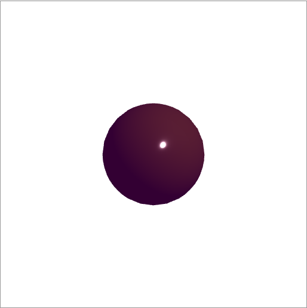
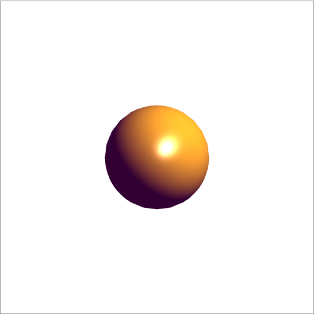

# HW 5: Lighting Models

A WebGL 2.0 demo that renders the same subdivided sphere with Gouraud, Phong, and Cook-Torrance shading, each running as its own GPU program and selected from a drop down menu.

## Overview

This project for my graphics class compares shading models on one scene. The requirements were:

- Demo three shading models on the same object, with a drop down menu to pick between them.
- Two models chosen from Flat, Gouraud, Phong, or Blinn-Phong, and a third that must be Cook-Torrance.
- Each model as a separate GPU program object, swapped when the user changes the menu.
- A one page PDF comparing two visibly different lighting results on the same object from the same angle, with labeled figures and an explanation of the code behind the difference.

## Features

- A unit sphere built by recursive subdivision of a tetrahedron, starting at 4 subdivisions.
- Shading Model menu: Gouraud (Per-Vertex), Phong (Per-Fragment), and Cook-Torrance (PBR).
- Buttons to change the camera radius R, the angles θ and φ, and the subdivision level, with a status line for the current model and level.
- A directional light at (1, 1, 1, 0) and a yellow diffuse material with shininess 20.

## How It Works

**Geometry.** `tetrahedron()` calls `divideTriangle()` on the four faces, splitting each triangle into four with midpoints pushed back onto the unit sphere. Each vertex position doubles as its normal, stored with w = 0. Positions and normals go into two buffers that all three programs share.

**Three programs, three VAOs.** `initShaders` is called once per shader pair (`vertex-shader-gouraud`, `-phong`, `-cooktorrance` and their fragment shaders). `setupProgram()` creates one VAO per program over the shared buffers, and `getUniforms()` caches uniform locations once at init time. Each frame, `render()` switches to the selected model with `gl.useProgram` and `gl.bindVertexArray`.

**Camera.** The eye comes from `radius`, `theta`, and `phi`, the view is `lookAt(eye, at, up)`, the projection is `ortho(-3, 3, -3, 3, -10, 10)`, and `normalMatrix()` gives the inverse transpose of the model view matrix.

**Gouraud.** Blinn-Phong lighting is computed per vertex in the vertex shader with the halfway vector `H = normalize(L + E)`. The fragment shader outputs the interpolated `vColor`, so the highlight is only as accurate as the vertex spacing.

**Phong.** The vertex shader passes `N`, `L`, and `E` as outputs. The fragment shader normalizes them again (interpolation shortens them) and runs Blinn-Phong for every pixel.

**Cook-Torrance.** A per fragment microfacet BRDF with a GGX normal distribution, Schlick Fresnel, and the Smith geometry term built from Schlick-GGX. Roughness comes from the shininess uniform as `clamp(1.0 / sqrt(uShininess), 0.05, 1.0)`. The diffuse part uses energy conservation, so light reflected as specular is removed from the diffuse term:

```glsl
float D = distributionGGX(NN, H, roughness);
float G = geometrySmith(NN, VV, LL, roughness);
vec3  F = fresnelSchlick(max(dot(H, VV), 0.0), F0);
vec3 specular = (D * G * F) / max(4.0 * NdotV * NdotL, 0.001);
vec3 kD = (1.0 - F);
vec3 Lo = (kD * uDiffuseProduct.rgb / PI + specular) * NdotL;
```

With `kD = 1.0 - F` and the Lambertian divide by π, Cook-Torrance comes out much darker than the additive Gouraud and Phong models, which is the comparison the report is built on.

## Bug Fixes

When the program was run again for this repository, the sphere filled the whole canvas instead of sitting in the middle. The cause was the small math library inside the file: its `flatten()` writes matrices row by row, but GLSL reads them column by column, so the model view and projection matrices reached the shader transposed. The fix sets the transpose flag to `true` on those two `uniformMatrix4fv` calls, which WebGL 2 allows. The normal matrix was left unchanged because uploading the row major inverse already gives the shaders the inverse transpose they need. The three preview images in this folder come from the fixed version.

## Files

- `HW5_LightingModels_DanielOni.html`: the demo, with all six shaders, a small vector and matrix library, its own `initShaders`, and the app code. This is the entry point.
- `HW5_LightingModels_Report_DanielOni.pdf`: the one page report comparing Gouraud and Cook-Torrance, with the relevant shader code. The two figure slots are labeled boxes.
- `HW5_LightingModels_DanielOni_Preview_cooktorrance.png`: preview capture of the Cook-Torrance model.
- `HW5_LightingModels_DanielOni_Preview_gouraud.png`: preview capture of the Gouraud model.
- `HW5_LightingModels_DanielOni_Preview_phong.png`: preview capture of the Phong model.

## How to Run It

Open `HW5_LightingModels_DanielOni.html` in a browser with WebGL 2.0, pick a model from the drop down, and use the buttons to move the camera or change the subdivisions. No other files are needed.

## Screenshots

These are preview captures of the program running in a browser. In order they show Cook-Torrance, Gouraud, and Phong.





