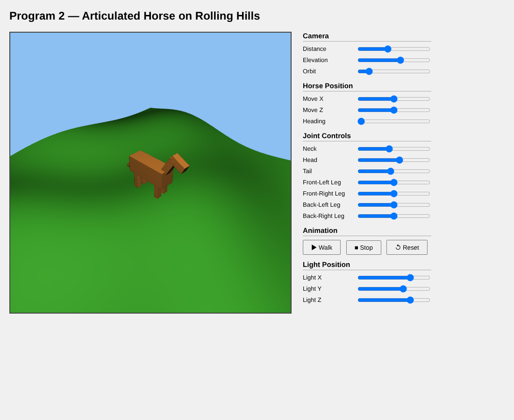

# Program 2: Articulated Horse on Rolling Hills

A WebGL 2.0 scene with a jointed horse built from instanced cubes, walking on a heightfield terrain under a movable point light, with per fragment Blinn-Phong shading and an orbiting perspective camera.

## Overview

This is the major WebGL project for my graphics class. The goals were:

- An articulated figure with at least two independent joints.
- The figure moving on a heightfield mesh on the XZ plane.
- Lighting, perspective projection, and camera controls.

## Features

- A horse made of 9 parts (body, neck, head, tail, and four legs), all drawn from one unit cube.
- Seven joints with their own sliders: Neck, Head, Tail, Front-Left Leg, Front-Right Leg, Back-Left Leg, Back-Right Leg.
- Horse Position sliders (Move X, Move Z, Heading) that keep the horse on the terrain surface.
- Camera sliders (Distance, Elevation, Orbit) for a camera that always looks at the horse.
- Light Position sliders for X, Y, and Z, with a small yellow cube marking the light.
- **Walk**, **Stop**, and **Reset** buttons.

## How It Works

**Code layout.** The JS file has two labeled sections: class style scaffolding (`var` globals, `window.onload = function init()`, `render()` with `requestAnimationFrame`, slider handlers) and a helper section using `const` and arrow functions (`chainMult`, `heightAt`, `generateTerrain`, `drawPart`, `updateAnimation`, and others). Matrices come from the class `MVnew.js`.

**Geometry and VAOs.** `generateUnitCube()` builds 36 vertices with flat per face normals. The terrain, the horse cube, and the light marker each get their own VAO, set up once in `init`.

**Terrain.** `heightAt(x, z)` adds three sine and cosine waves:

```js
const heightAt = (x, z) => {
    return 0.40 * Math.sin(0.50 * x) * Math.cos(0.50 * z)
         + 0.20 * Math.cos(0.70 * x + 0.40 * z)
         + 0.15 * Math.sin(0.35 * x - 0.55 * z);
};
```

`generateTerrain(40, 8.0)` samples it on a 40 by 40 grid from -8 to 8 in X and Z. Normals come from central differences of the height function in `terrainNormalAt`, so the shading is smooth across triangles.

**Hierarchical model.** Every horse part starts from the same world transform, which places the horse on the terrain and turns it to its heading:

```js
var horseY = heightAt(horseX, horseZ);
var world  = chainMult(translate(horseX, horseY, horseZ), rotateY(horseHeading));
```

Each joint then uses the pivot pattern: translate to the joint, rotate, translate by half the part length so the end of the cube sits on the pivot, and scale. The head repeats the neck chain before adding its own rotation, so tilting the neck carries the head with it:

```js
drawPart(viewMatrix, chainMult(
    world, neckPivot,
    rotateZ(neckAngle),
    translate(0, neckL, 0),          // top of neck
    rotateZ(headAngle),
    translate(headW * 0.35, 0, 0),   // extend head forward
    scale(headW, headH, headD)
));
```

`drawPart` uploads the model matrix and a normal matrix computed as `normalMatrix(mult(viewMat, modelMat), true)`. The inverse transpose keeps the normals correct on the long, thin, non-uniformly scaled leg and tail cubes.

**Matrices and projection.** `uModelMatrix` and `uViewMatrix` are separate uniforms because each part has its own model matrix while the view stays fixed for the frame. The camera eye is placed with spherical coordinates around a look-at point at the horse, and the projection is `perspective(55.0, aspect, 0.1, 100.0)`.

**Lighting.** The vertex shader moves the world space light into eye space with `uViewMatrix * uLightPosition` and passes `N`, `L`, and `E` to the fragment shader, which computes ambient, diffuse, and Blinn-Phong specular with the halfway vector. `setMaterial` uploads separate light times material products for the horse, the terrain, and the bright yellow light marker.

**Walk cycle.** `updateAnimation` swings the legs 25 degrees in diagonal pairs (front-left with back-right, front-right with back-left), adds a small neck, head, and tail bob, and moves the horse forward along its heading. The position is clamped to ±6.5 so it stays on the terrain.

## Files

- `CG_S26_Program2_OniDaniel.html`: canvas, slider panel, and the inline `#version 300 es` shaders. This is the file to open.
- `CG_S26_Program2_OniDaniel.js`: class style scaffolding plus the labeled helper section.
- `MVnew.js`: the class vector and matrix library.
- `initShaders.js`: the class utility that compiles and links the shaders.
- `CG_S26_Program2_StudyGuide.md`: presentation study guide covering the projection, view, and model matrices, lighting, and the joint hierarchy.
- `CG_S26_Program2_OniDaniel_Preview.png`: preview capture of the scene running in a browser.

## How to Run It

Keep `MVnew.js` and `initShaders.js` next to the HTML file and open `CG_S26_Program2_OniDaniel.html` in Chrome or Firefox. No server is needed since nothing loads a texture or a camera. Drag the sliders or hit Walk.

## Screenshots

These are preview captures of the program running in a browser.


