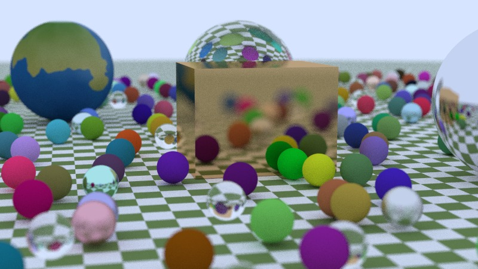

# HW6: Ray Tracing (Based on Ray Tracing in One Weekend)

A C++17 path tracer extended from the Ray Tracing in One Weekend code with procedural and image textures, a quad primitive, a box built from quads, and a procedurally generated earth texture.

## Overview

This project for my graphics class turns the book's C++ ray tracer into a custom ray traced scene. The options were a large field of varied spheres, a new geometry type with proper normals, or texture mapping. This scene uses all three. The submission is a JPG plus technical specs: resolution, samples per pixel, bounce depth, render time on my own CPU, and camera location.

## Features

- A checkered ground plane made from a sphere of radius 1000.
- A field of small random spheres: mostly diffuse, plus metal with random fuzz, solid glass, and hollow glass bubbles.
- Three large feature spheres (clear glass, a procedurally textured earth, and polished silver) and a copper box built from six quads.
- Defocus blur that keeps the feature objects sharp and softens the far corners.

## How It Works

**Core structure.** The code keeps the book layout of one header per class. `camera::ray_color` recurses: each hit asks the material (`lambertian`, `metal`, or `dielectric`) to scatter, multiplies by its attenuation, and stops at `max_depth` or when the ray escapes to the sky color. The image is gamma corrected and written as a PPM to standard output.

**Textures.** The hit record carries `u` and `v`, and `lambertian` takes a `texture` instead of a fixed color. `texture.h` defines `solid_color`, a `checker_texture` that picks a color from the parity of the floored world space x, y, and z of the hit point, and an `image_texture` loaded through `rtw_stb_image.h` and `stb_image.h`. `sphere.h` fills in `u` and `v` with a spherical mapping, so the earth image wraps onto its sphere.

**Quad and box.** `quad.h` defines a parallelogram from a corner `Q` and two edge vectors `u` and `v`. The normal is computed once in the constructor, so the order of the edge vectors decides which way the face points:

```cpp
auto n = cross(u, v);
normal = unit_vector(n);
D = dot(normal, Q);
w = n / dot(n, n);
```

The hit test solves the ray against the plane for t, then accepts the hit only if its planar coordinates (alpha, beta) are both in [0, 1]. Those values become the hit's u and v. The `box(a, b, mat)` helper builds six quads with edge vectors chosen so every face points outward, and returns them in a `hittable_list`.

**Hollow glass.** A bubble is two dielectric spheres at the same center, one with radius 0.2 and one with radius -0.15. The negative radius flips the inner sphere's normal, so the glass treats its inside as air.

**Earth texture generator.** `make_earthmap.py` uses NumPy and Pillow to build a 1024 by 512 equirectangular `earthmap.jpg` from layered value noise: oceans, continents covering about 30 percent of the surface, biome colors, polar ice caps, and faint clouds. The seeds are fixed, so the output is reproducible.

**Scene and render settings.** From `main.cc`:

| Setting | Value |
| --- | --- |
| Resolution | 800 x 450 (16:9) |
| Samples per pixel | 300 |
| Max bounce depth | 50 |
| Camera lookfrom / lookat / vup | (13, 2, 3) / (0, 0, 0) / (0, 1, 0) |
| Vertical field of view | 20 degrees |
| Defocus angle / focus distance | 0.6 degrees / 10.0 |
| Render time | 19 minutes 5 seconds on my machine |

The glass sphere is at (0, 1, 0), the earth at (-2.5, 1, 3.0), the silver sphere at (4.5, 1, -2.5), and the copper box runs from (2.0, 0, -0.5) to (3.6, 1.4, 1.4). The random sphere loop skips positions near these objects. There is no BVH, so every ray tests every object, which keeps the code readable at the cost of render time.

## Files

- `src/`: all headers, `main.cc`, `make_earthmap.py`, the generated `earthmap.jpg`, and `stb_image.h` (third party, public domain).
- `build_and_run.md`: build and run notes for Linux, macOS, Windows, and WSL, plus how to regenerate the earth texture.
- `CG_HW6_RayTracing_TechSpecs_DanielOni.pdf`: technical specs and a discussion of the extensions and render settings.
- `CG_HW6_RayTracing_DanielOni_Preview_100spp.jpg`: preview render of the final scene at 100 samples per pixel.

## How to Run It

On Windows with Visual Studio 2019, open a Developer PowerShell in `src/` and run:

```
cl /O2 /std:c++17 /EHsc main.cc /Fe:rt.exe
Measure-Command { .\rt.exe > image.ppm }
```

With g++ (Linux, macOS, WSL, or MinGW):

```
g++ -O3 -std=c++17 -o rt main.cc
./rt > image.ppm
```

Run it from the folder with `earthmap.jpg`, then export the PPM to JPG in GIMP or IrfanView. The random sphere field is unseeded, so it changes between builds.

## Render

This is a preview render of the final scene at 100 samples per pixel instead of the 300 I used for my submitted image, so it is a little noisier. My full 300-sample render took about 19 minutes on my own machine.


