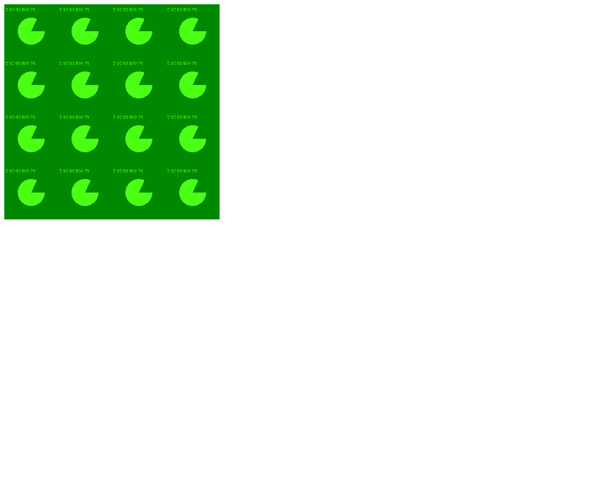

# Texture Lab: Webcam Grid

A WebGL 2 page that captures a live webcam feed and tiles it across the canvas as a 4 x 4 grid, using nothing but texture coordinates and the texture wrap mode.

## Overview

This lab for my graphics class focused on texture coordinates as vertex attributes and on how the wrap mode can be used to create different effects. The goal was to start from the class webcam starter and build a display that shows a grid of the webcam image, with the feed repeated in every tile. The grid could be 3 x 3 or 4 x 4. This version draws a 4 x 4 grid, and the size is controlled by a single variable.

## Features

- Live webcam video uploaded to a WebGL texture on every frame
- A 4 x 4 grid of the feed on a 400 by 400 canvas
- Grid size set by one variable, `N`, so switching to 3 x 3 is a one line change
- Video shown right side up
- One full screen quad and an unchanged pass-through fragment shader

## How It Works

The geometry is a single quad made of two triangles covering clip space from (-1, -1) to (1, 1). Normally its texture coordinates run from 0 to 1. Here they run from 0 to `N` on both axes:

```js
// Grid size: N x N.  Change to 3 for a 3x3 grid, 4 for 4x4, etc.
var N = 4;
```

The texture coordinate array uses `0` and `N` at the corners, so the bottom left corner gets (0, 0) and the top right gets (4, 4). The second half of the effect is the wrap mode:

```js
gl.texParameteri(gl.TEXTURE_2D, gl.TEXTURE_WRAP_S, gl.REPEAT);
gl.texParameteri(gl.TEXTURE_2D, gl.TEXTURE_WRAP_T, gl.REPEAT);
```

With `gl.REPEAT`, the sampler only uses the fractional part of a coordinate, so 2.3 reads the same texel as 0.3. As the interpolated coordinate climbs from 0 to 4 across the quad, it passes through four full cycles on each axis, and the GPU produces 16 copies of the video without any extra geometry. The fragment shader is the same lookup the starter uses:

```glsl
fColor = vec4( texture( texturevid, vTexCoord ).rgb, 1. );
```

Both `TEXTURE_MIN_FILTER` and `TEXTURE_MAG_FILTER` are `gl.NEAREST`.

**Orientation.** Video frames arrive with row 0 at the top, while texture coordinate t = 0 is the bottom of the quad. `gl.pixelStorei(gl.UNPACK_FLIP_Y_WEBGL, true)` flips the rows on upload so the image is upright.

**Webcam pipeline.** The async `setup()` function calls `accessWebcam(video)`, which wraps `getUserMedia` with a 400 by 400 video constraint and resolves once the metadata loads. The texture lives on unit 0, and the `texturevid` sampler is pointed there once in `init()` with `gl.uniform1i(textureloc, 0)`. The `render()` loop uploads the current frame with `texImage2D` and draws six vertices, then schedules itself with `requestAnimationFrame`.

**Starter notes.**

- The starter has `gl.RCLAMP_TO_EDGE` on the WRAP_S line. That constant does not exist, so the call does nothing. Both wrap settings are now `gl.REPEAT`.
- The starter passes the video element to `texImage2D` inside `init()`, before the camera stream is attached. The first call now allocates a 400 by 400 texture with `null`, and `render()` only uploads a frame when `video.readyState >= video.HAVE_CURRENT_DATA`.
- The script path `../Common/initShaders.js` is now `initShaders.js` in the same folder.

## Files

- `CG_TextureLab_WebcamGrid_OniDaniel.html`: the program, with both shaders embedded in the page
- `CG_TextureLab_WebcamGrid_Writeup_OniDaniel.pdf`: a short writeup explaining how the grid effect is produced
- `CG_TextureLab_WebcamGrid_OniDaniel_Preview.png`: preview capture shown below
- `initShaders.js`: the class utility that compiles and links the shaders

## How to Run

The webcam will not work if the file is opened by double clicking, because browsers block the camera on `file://` pages. With `initShaders.js` next to the HTML, serve the folder:

```
python -m http.server 8000
```

Then open `http://localhost:8000/CG_TextureLab_WebcamGrid_OniDaniel.html` and allow the camera. VS Code Live Server also works.

## Screenshots

These are preview captures of the program running in a browser. They were taken with a test camera instead of a real webcam, which is why the video shows a green test pattern instead of a person.


