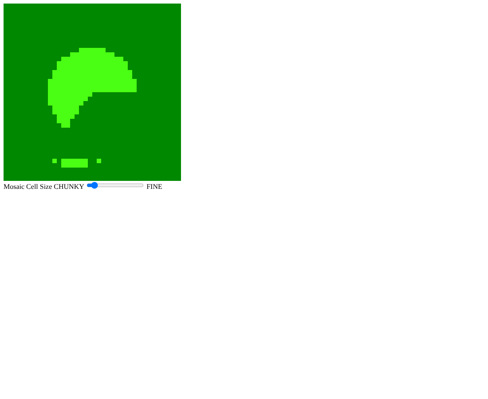

# Webcam Mosaic Filter

A WebGL 2 photo filter that turns a live webcam feed into a mosaic of square tiles, with a slider that controls how coarse or fine the tiles are.

## Overview

This project for my graphics class starts from the class webcam starter and changes the fragment shader so it applies a photo editing filter to the live video, using one of the image processing techniques covered in lecture. The filter here is a mosaic, also called pixelation. The vertex shader, geometry, and webcam code stay the same as the starter, and all of the effect happens in the fragment shader.

## Features

- Live webcam feed drawn on a 400 by 400 canvas
- Mosaic filter applied per fragment in real time
- Slider labeled CHUNKY to FINE that sets the number of mosaic cells across the image, from 5 to 400, starting at 40
- Each cell shows one solid color taken from the center of that cell in the video frame

## How It Works

The fragment shader has a `uBlocks` uniform for the number of cells across the image. The normal texture lookup was replaced with a snapped coordinate:

```glsl
vec2 snappedCoord = (floor(vTexCoord * uBlocks) + 0.5) / uBlocks;

fColor = vec4( texture( texturevid, snappedCoord ).rgb, 1.0 );
```

Step by step:

1. `vTexCoord * uBlocks` scales the 0 to 1 coordinate up to a cell index range.
2. `floor()` drops the fraction, so every fragment inside one cell gets the same integer index.
3. Adding `0.5` moves the sample point to the middle of the cell.
4. Dividing by `uBlocks` puts the value back into 0 to 1 texture space.

Since every fragment in a cell reads the same texel, the cell is filled with one flat color, and the video turns into large square tiles. A low `uBlocks` value gives a few big tiles, and a high value gets closer to the original image.

**Uniforms and controls.** The slider follows the class Hello Slider pattern: a range input inside a `<div>` with label text on each side. The `uBlocks` location is looked up once in `init()` and stored in `uBlocksLoc`. The slider `onchange` handler updates a `blocks` variable, and `render()` sends it each frame with `gl.uniform1f(uBlocksLoc, blocks)`. Because it uses `onchange`, the tile size updates when the slider is released.

**Texture setup.** The video texture is on unit 0 and read through the `texturevid` sampler. Wrap mode is `gl.CLAMP_TO_EDGE` on both axes, and both filters are `gl.NEAREST`.

**Starter notes.**

- The starter has `gl.RCLAMP_TO_EDGE` on the WRAP_S line, which is not a real WebGL constant, so that call did nothing. It is now `gl.CLAMP_TO_EDGE`.
- The first `texImage2D` in the starter receives the video element before the camera is ready. That call now allocates a 400 by 400 texture with `null`, and the render loop uploads real frames after that.
- The script path `../Common/initShaders.js` is now `initShaders.js`, so the page runs with the utility sitting next to it.

## Bug Fixes

- The render loop was passing the video to `texImage2D` before the webcam had produced any frames, which filled the console with warnings for the first second or so. The loop now checks `video.readyState >= video.HAVE_CURRENT_DATA` before each upload, the same guard used in the HW7 files, so it only uploads once a frame is ready.

## Files

- `CG_WebcamMosaic_OniDaniel.html`: the program, with both shaders and the slider in the page
- `CG_WebcamMosaic_Explanation_OniDaniel.pdf`: a short explanation of how the filter works
- `CG_WebcamMosaic_OniDaniel_Preview.png`: preview capture shown below
- `initShaders.js`: the class utility that compiles and links the shaders

## How to Run

From this folder, with `initShaders.js` in it:

```
python -m http.server 8000
```

Open `http://localhost:8000/CG_WebcamMosaic_OniDaniel.html` in Chrome and allow the camera. VS Code Live Server works too. The slider uses `onchange`, so the tile size updates when you let go of it. Values around 25 to 40 give clear, chunky tiles for a screenshot.

## Screenshots

These are preview captures of the program running in a browser. They were taken with a test camera instead of a real webcam, which is why the video shows a green test pattern instead of a person.


