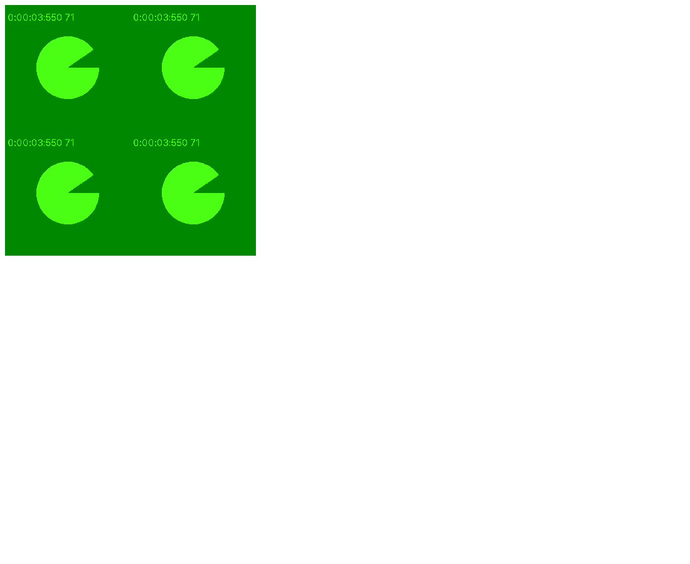
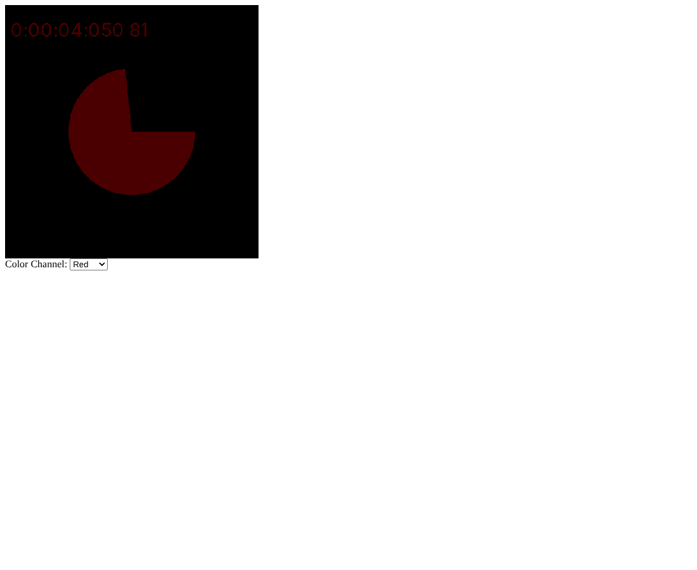
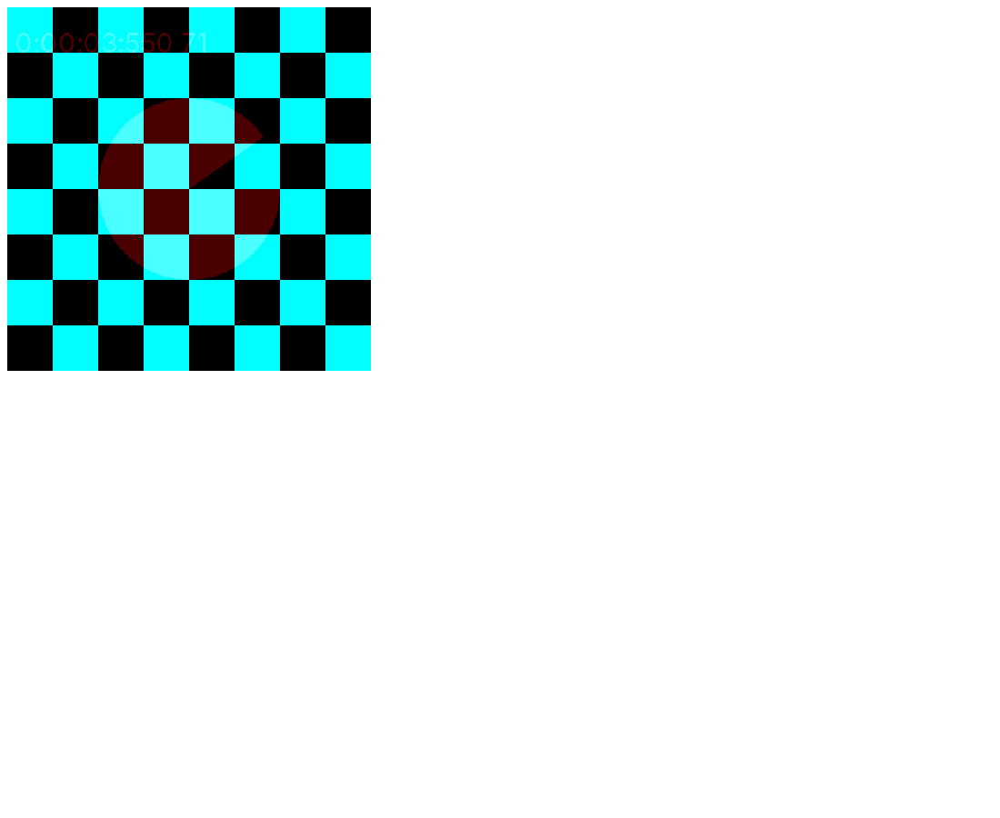

# HW7: Webcam Textures (Parts A, B, and C)

Three WebGL 2 programs built on a live webcam texture: a tiled 2 x 2 grid, a color channel selector, and a two texture composite that masks the video with a checkerboard.

## Overview

HW7 for my graphics class had three parts, all built on the class webcam starter. Part A tiles the feed into an upright 2 x 2 grid and documents how the quad corners map to texture coordinates. Part B, "Colorful Me," adds a menu that picks which color channel of the video is shown. Part C combines two textures at the same time and comes with a short lab report.

## Features

- **Part A:** four upright copies of the live feed from one quad, plus a mapping diagram
- **Part B:** a Color Channel dropdown for the red, green, or blue channel
- **Part C:** the webcam on texture unit 0 and a 64 by 64 checkerboard on unit 1, combined per fragment

## How It Works

Each program draws one full screen quad and uploads the current video frame to texture unit 0 in `render()`. The `texturevid` sampler is set to unit 0 once in `init()`.

### Part A: 2 x 2 Grid

The vertex positions stay the same, and the texture coordinates are scaled from [0, 1] to [0, 2]:

```js
var texCoord = new Float32Array ([
    0,   0,
    0,   2.0,
    2.0, 2.0,
    2.0, 2.0,
    2.0, 0,
    0,   0
]);
```

Both wrap modes are `gl.REPEAT`, so when the coordinate crosses 1.0 the sampler wraps back to 0 and each axis shows the video twice. The fragment shader is unchanged from the starter. `gl.pixelStorei(gl.UNPACK_FLIP_Y_WEBGL, true)` flips the image upright, which keeps the coordinate array symmetric. The diagram marks s = 1 and t = 1, where the wrap happens.

### Part B: Colorful Me

A `<select>` sets an `int` uniform called `uChannel` through `gl.uniform1i(uChannelLoc, channel)` in its `onchange` handler. The fragment shader keeps the chosen channel and zeroes the other two:

```glsl
vec4 texColor = texture( texturevid, vTexCoord );

if (uChannel == 0) {
    fColor = vec4( texColor.r, 0.0, 0.0, 1.0 );
} else if (uChannel == 1) {
    fColor = vec4( 0.0, texColor.g, 0.0, 1.0 );
} else {
    fColor = vec4( 0.0, 0.0, texColor.b, 1.0 );
}
```

### Part C: Two Textures

A procedural checkerboard from the class Two Textures example goes on `gl.TEXTURE1` and is read by a second sampler, `texturevid2`. An XOR of bit tests gives squares 8 texels wide:

```js
var c = (((i & 0x8) == 0) ^ ((j & 0x8) == 0));
```

The pattern is converted to a `Uint8Array` and uploaded once. The fragment shader takes red from the video and green and blue from the checker:

```glsl
fColor = vec4( tex1.r, tex2.bg, 1.0 );
```

In black squares only the red channel of the video survives, and in white squares green and blue are at full strength, so the checker works as a mask over the feed. The Y flip is a global pixel store setting, so it is turned off just for the checkerboard upload and back on afterward to keep the checker from being mirrored.

### Starter Notes

- The starter has `gl.RCLAMP_TO_EDGE` on the WRAP_S line, which is not a real constant. It is fixed in all three files.
- The starter passes the video into `texImage2D` during `init()`, before `getUserMedia` has finished. That call now allocates a 400 by 400 texture with `null`, and the render loop checks `video.readyState >= video.HAVE_CURRENT_DATA` before uploading.

## Bug Fixes

- Part B did not compile because a fragment shader variable was named `sample`, a reserved word in GLSL ES 3.00, so nothing drew. The variable is now `texColor`, and Part B runs correctly.

## Files

- `CS5382_S26_HW7A_TextureStudy_DanielOni.html`: Part A program
- `CS5382_S26_HW7A_TextureStudy_DanielOni.pdf`: Part A report with the mapping diagram
- `CS5382_S26_HW7A_TextureStudy_DanielOni_Preview.png`: Part A preview capture
- `texture_mapping_diagram.png`: diagram of quad corners mapped to texture coordinates
- `CS5382_S26_HW7B_ColorfulMe_DanielOni.html`: Part B program
- `CS5382_S26_HW7B_ColorfulMe_DanielOni_Preview.png`: Part B preview capture
- `CS5382_S26_HW7C_TwoTextures_DanielOni.html`: Part C program
- `CS5382_S26_HW7C_TwoTextures_LabReport.pdf`: Part C lab report
- `CS5382_S26_HW7C_TwoTextures_DanielOni_Preview.png`: Part C preview capture

## How to Run

All three files keep the `<script src="../Common/initShaders.js">` path from the starter, so `initShaders.js` has to sit in a folder named `Common` one level up from these files. This repository has that `Common` folder at its root. Otherwise, change that path in each file. Then serve the files, because the camera is blocked on `file://`. Serving from the repository root keeps the `../Common` path reachable:

```
python -m http.server 8000
```

Open `http://localhost:8000/17-hw7-webcam-textures/` plus the file name in Chrome and allow the camera. VS Code Live Server also works.

## Screenshots

These are preview captures of the program running in a browser. They were taken with a test camera instead of a real webcam, which is why the video shows a green test pattern instead of a person.






