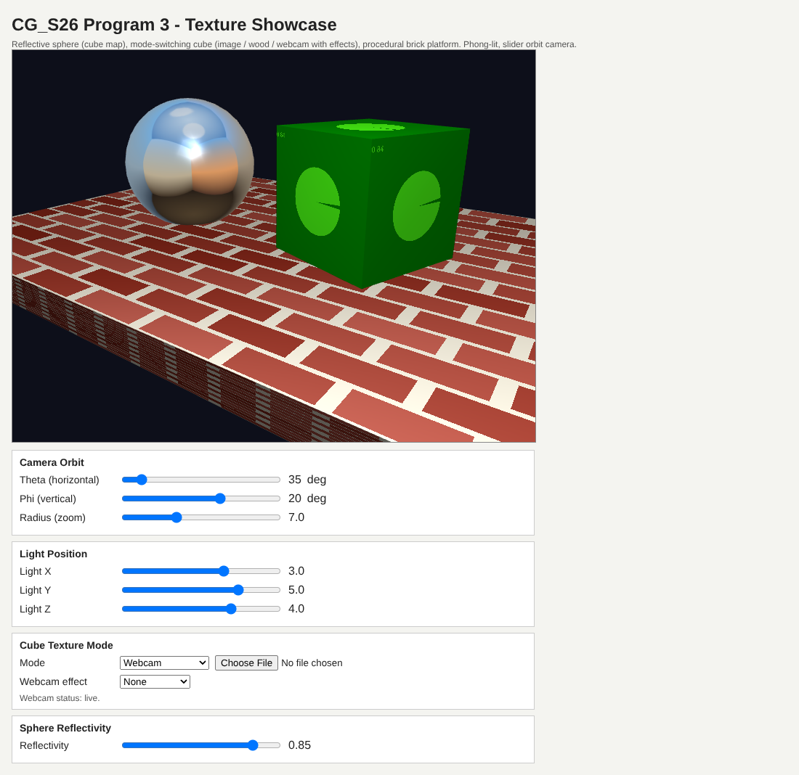

# Program 3: Texture Showcase Scene

A Phong lit WebGL 2 scene that shows several texture techniques at once: a cube mapped reflective sphere, a cube that switches between an uploaded image, procedural wood, and a filtered live webcam, and a procedural brick platform.

## Overview

Program 3 was the texture project for my graphics class. The goals were to apply at least three different texture techniques to 3D objects with real depth, light the scene, and give the user intuitive controls, with extra credit for an advanced technique such as environment mapping. One rule shaped the design: the solution could not require a local server, which rules out loading image files from disk on a `file://` page. Every texture is therefore generated in code, uploaded by the user, or streamed from the webcam.

## Features

- **Reflective sphere** with environment mapping from a procedurally painted cube map, plus a specular highlight
- **Display cube** with three modes: uploaded image, procedural wood, and live webcam
- **Webcam effects:** none, grayscale, Sobel edge detection, and sepia
- **Brick platform** generated in the fragment shader
- **Orbit camera** sliders for theta (0 to 360), phi (-80 to 80), and radius (3 to 15)
- **Light position** sliders for X, Y, and Z, plus a sphere **reflectivity** slider
- **Webcam status line** that reports live, unsupported, or blocked

## How It Works

### Programs and Geometry

Two shader programs share one vertex shader: `programEnv` uses `fragment-shader-env` for the sphere, and `programTex` uses `fragment-shader-tex` for the cube and platform. The vertex shader outputs eye space `vN`, `vL`, and `vE` for Phong lighting, and world space `vWorldPos` and `vWorldNormal` for reflection.

`buildSphere(4)` subdivides a tetrahedron four times, as in the class `shadedSphere2.js`. `buildBox(sx, sy, sz)` builds 36 vertices with face normals and 0 to 1 UVs for the cube and the platform slab. Each object gets its own VAO through `makeVAO()`.

### Environment Mapped Sphere

`generateCubeMapFaces()` paints six 256 by 256 canvases with 2D gradients (sky with clouds, ground, and four sides) and uploads each to its `TEXTURE_CUBE_MAP` face, with generated mipmaps, `LINEAR_MIPMAP_LINEAR`, and `CLAMP_TO_EDGE`. The shader reflects the view vector in world space:

```glsl
vec3 V = normalize(uEyeWorld - vWorldPos);
vec3 N = normalize(vWorldNormal);
vec3 R = reflect(-V, N);
vec4 envColor = texture(uCubeMap, R);
```

The reflection is mixed with an ambient tint by `uReflectivity`, and a specular term using the halfway vector `H = normalize(vL + vE)` is added on top.

### Textured Cube and Platform

`fragment-shader-tex` picks its color source with an integer `uMode` uniform:

| `uMode` | Source |
|---|---|
| 0 | uploaded image |
| 1 | procedural wood |
| 2 to 5 | webcam: none, grayscale, Sobel, sepia |
| 6 | procedural brick (platform) |

- **Wood** (`woodColor`) uses concentric sine rings with a small hash based grain term.
- **Brick** (`brickColor`) scales UVs into an 8 by 16 grid, offsets alternate rows by half a brick, draws mortar with `step()`, and jitters each brick color.
- **Grayscale** uses luminance weights (0.299, 0.587, 0.114), and **sepia** applies a sepia color matrix.
- **Sobel** (`sobelEdges`) samples the 3 x 3 neighborhood as luminance and returns the gradient magnitude. A `uTexel` uniform holds one over the video size, so the kernel steps one texel at any webcam resolution.

Every mode then gets ambient, diffuse, and specular Phong terms with the texture color as the material color.

### Image Upload and Webcam

The file input reads an image with `FileReader`, uploads it to `imageTex` with mipmaps and `REPEAT` wrapping, and switches the cube to image mode.

The webcam texture starts as a 1 by 1 gray placeholder. A `webcamReady` flag is set once the 512 by 512 stream loads, and `render()` only uploads when that flag is true and `video.readyState >= video.HAVE_CURRENT_DATA`. With `CLAMP_TO_EDGE` and this guard, the program avoids the two problems in the class webcam starter: the `gl.RCLAMP_TO_EDGE` typo and calling `texImage2D` on a video with no frames yet.

### Camera

`computeEye()` turns theta, phi, and radius into a point on a sphere around the origin. Each frame builds `lookAt(eye, at, up)` and `perspective(45.0, aspect, 0.1, 100.0)` with depth testing on.

## Files

- `CG_S26_Program3_OniDaniel.html`: canvas, both sets of shaders, and all the controls
- `CG_S26_Program3_OniDaniel.js`: geometry, textures, camera, and the render loop
- `CG_S26_Program3_OniDaniel_Preview.png`: preview capture shown below
- `initShaders.js`: class utility that compiles and links the shaders
- `MVnew.js`: class matrix and vector library

## How to Run

With `initShaders.js` and `MVnew.js` next to the HTML, just double-click `CG_S26_Program3_OniDaniel.html`. No server is needed. Chrome or Edge work best. Allow the camera when the browser asks. The cube starts in webcam mode, and if the camera is blocked you can still switch to wood or upload an image.

## Screenshots

These are preview captures of the program running in a browser. They were taken with a test camera instead of a real webcam, which is why the video shows a green test pattern instead of a person.


